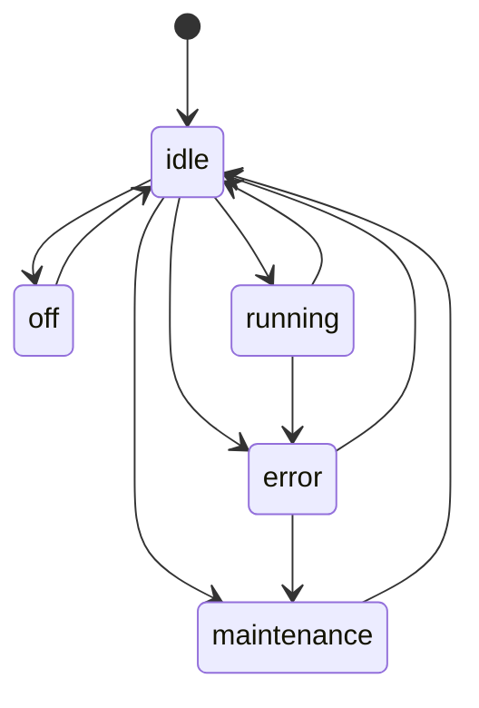

# State — Actuator Lifecycle

## Problem

An actuator such as a pump or a grow light has a lifecycle. It can be idle,
running, switched off, in error or under maintenance. Not every move makes
sense: a pump under maintenance must not start, and a running pump must be
stopped before it is switched off.

Modelling this with boolean flags (`is_running`, `is_fault`,
`is_maintenance`) allows impossible combinations, and every method needs its
own `if` guards. The dashboard also cannot ask what is allowed right now.

## Intent

State lets an object change its behaviour when its internal state changes.
Each state is an object that knows which states can follow it and which
commands are allowed in it.

## Participants

| Role | In this application |
| --- | --- |
| Context | `ActuatorContext` holds the current state and delegates to it |
| State interface | `ActuatorState` |
| Concrete states | `OffState`, `IdleState`, `RunningState`, `ErrorState`, `MaintenanceState` |
| Client | `ActuatorStateService`, the devices API and the dashboard |

## Legal transitions

| From | To |
| --- | --- |
| `off` | `idle` |
| `idle` | `running`, `maintenance`, `error`, `off` |
| `running` | `idle`, `error` |
| `error` | `idle`, `maintenance` |
| `maintenance` | `idle` |

Every other move is illegal, including a move to the same state. For
example `running → maintenance` and `running → off` are rejected: the
actuator must go back to `idle` first. `error → idle` is the reset.



## Allowed commands

`allowed_commands` answers "what can I do now?". It depends on the state
and on the device type. Phase 10 reuses these command names.

| State | `water_pump` | `grow_light` |
| --- | --- | --- |
| `idle` | `start_pump` | `set_light_level` |
| `running` | `stop_pump` | `set_light_level` |
| `off`, `error`, `maintenance` | none | none |

Sensors have no lifecycle: their `state` is `null` and their
`allowed_commands` is empty.

## Guard

`ActuatorContext.transition(target)` is the only way to change the state.
It raises:

- `UnknownStateError` when the target is not one of the five states
- `IllegalTransitionError` when the current state does not allow the target

The service calls `transition` before it saves, so a rejected move never
reaches the database.

## Persistence

The state is stored in the `actuator_states` table, not in process memory.

| Column | Type |
| --- | --- |
| `device_id` | UUID primary key, foreign key to `devices` |
| `state` | VARCHAR(32) |
| `updated_at` | timestamptz |

Only the state name is stored. On load, the name is turned back into a
state object with `get_state(name)`. After a backend restart every actuator
is still in the state it was left in.

**Seeding:** the migration inserts `idle` for every actuator that existed
before this phase. Actuators provisioned later get `idle` when they are
created. A missing row resolves to `idle`.

## API

Device JSON gains two fields:

```json
{
  "id": "<uuid>",
  "role": "actuator",
  "state": "idle",
  "allowed_commands": ["start_pump"]
}
```

`POST /api/devices/{device_id}/transition` with `{ "target": "running" }`
is a demo endpoint. Phase 10 will change state through commands instead.

| Case | Status |
| --- | --- |
| Legal transition | 200 with the updated device |
| Illegal transition | 409 |
| Unknown target state | 400 |
| Missing device, or a sensor | 404 |

409 is used for an illegal transition because the request is well formed
but conflicts with the current state of the resource.

## Where in code

| Role | File |
| --- | --- |
| States and registry | `backend/src/domain/actuators/state.py` |
| Context | `backend/src/domain/actuators/context.py` |
| Service | `backend/src/application/devices/actuator_state_service.py` |
| DTO fields | `backend/src/application/devices/dto.py` |
| Repository | `backend/src/infrastructure/persistence/actuator_state_repository.py` |
| `ActuatorStateRow` | `backend/src/infrastructure/persistence/models.py` |
| API routes | `backend/src/interfaces/api/devices.py` |
| Badge and control | `frontend/src/components/devices/` |
| Tests | `backend/tests/test_actuator_state.py`, `backend/tests/test_actuator_state_api.py` |

## State and Strategy

Both delegate to an object behind a common interface. A strategy is a
policy the operator chooses and saves (Phase 6). A state is a lifecycle
position that changes because of events on the actuator itself.

## Exercise: add a state

Add a `standby` state that can only be reached from `idle` and can only
return to `idle`. Create `StandbyState`, add `"standby"` to the targets of
`IdleState`, register it in `_STATES`, and add the new edges to
`LEGAL_EDGES` in the test. The context, service, repository and router stay
unchanged.
